# CHAPTER THREE

**Regression with penalization: Ridge regression** (with some OLS matrix algebra)

- Module Code: **EC4308**
- Module Title: **Machine Learning and Economic Forecasting**
- Instructor: **Vu Thanh Hai**
- Reference: ISLR 6.2.1 (review OLS linear algebra: Stock and Watson, 3rd ed., Section 18.1)
- *Acknowledgment: adapted from Dr. Denis Tkachenko's notes with minor modifications. Thanks to Denis!*

# Lecture outline

1. Brief review of OLS algebra (matrix form, matrix differentiation).
2. A shortcut for LOOCV in OLS (hat matrix and leverage).
3. Why shrink? Drawbacks of subset selection; James–Stein shrinkage.
4. Ridge regression: estimator, shrinkage and the bias–variance trade-off – with an interactive demo.
5. Choosing $\lambda$ by cross-validation.
6. Application: Credit data. Ridge vs. OLS and best subset.
7. Concluding remarks and the link to LASSO (next lecture).

> **Roadmap:** ridge = OLS + a penalty on the size of $\beta$. To derive it, and to tune $\lambda$ cheaply by leave-one-out CV, we first need OLS in matrix form; the hat-matrix LOOCV shortcut is what makes cheap tuning of $\lambda$ possible.

# OLS with one regressor (scalar notation)

- Our OLS model: $Y_i = \alpha + \beta X_i + u_i$
- To find the best linear model, we minimize $\sum_{i=1}^{N}\left(Y_i - \alpha - \beta X_i\right)^2$; the first-order conditions are
  $$\text{w.r.t. } \beta:\; -2\sum_{i=1}^{N}\left(Y_i-\alpha-\beta X_i\right)X_i = 0, \qquad \text{w.r.t. } \alpha:\; -2\sum_{i=1}^{N}\left(Y_i-\alpha-\beta X_i\right) = 0$$
- Solve to get the OLS estimator:
  $$\hat\beta = \frac{\sum_{i=1}^{N}(X_i-\bar X)(Y_i-\bar Y)}{\sum_{i=1}^{N}(X_i-\bar X)^2}, \qquad \hat\alpha = \bar Y - \hat\beta \bar X$$

# OLS with one regressor (scalar notation)

- It was easy with one regressor because we can represent the problem in scalar form.
- With multiple regressors we need matrix algebra. There is a linear-algebra formula that applies to all linear regression (OLS) problems.
- This is something you should have learned in EC3303 and EC3304; if you covered it only briefly (or not at all), we go through it again here.

# OLS in matrix form

- True linear model with multiple regressors:
  $$y_i = \beta_0 + \beta_1 x_{1,i} + \beta_2 x_{2,i} + \dots + \beta_p x_{p,i} + u_i \quad \text{for each observation } i$$
- In matrix form, taking all observations into consideration:
  $$\underbrace{\begin{bmatrix} y_1\\ y_2\\ \vdots\\ y_N\end{bmatrix}}_{N\times 1} = \underbrace{\begin{bmatrix} 1 & x_{11} & x_{21} & \cdots & x_{p1}\\ 1 & x_{12} & x_{22} & \cdots & x_{p2}\\ \vdots & \vdots & \vdots & & \vdots\\ 1 & x_{1N} & x_{2N} & \cdots & x_{pN}\end{bmatrix}}_{N\times(p+1)} \underbrace{\begin{bmatrix} \beta_0\\ \beta_1\\ \vdots\\ \beta_p\end{bmatrix}}_{(p+1)\times 1} + \underbrace{\begin{bmatrix} u_1\\ u_2\\ \vdots\\ u_N\end{bmatrix}}_{N\times 1}$$

# OLS in matrix form

- Estimation model: $y_i = \hat\beta_0 + \hat\beta_1 x_{1,i} + \dots + \hat\beta_p x_{p,i} + e_i$ for each observation $i$, i.e. $\mathbf{y} = \mathbf{X}\hat{\boldsymbol\beta} + \mathbf{e}$.
- **Be careful not to mix up the matrix indexing!** In the design matrix, $x_{ji}$ is regressor $j$ for observation $i$ (row $i$, column $j+1$) – whereas a generic matrix is indexed $a_{\text{row},\text{col}}$:
  $$\mathbf{A} = \begin{bmatrix} a_{11} & a_{12} & a_{13} & \cdots & a_{1k}\\ a_{21} & a_{22} & a_{23} & \cdots & a_{2k}\\ \vdots & \vdots & \vdots & & \vdots\\ a_{m1} & a_{m2} & a_{m3} & \cdots & a_{mk}\end{bmatrix}$$

# OLS: solve using linear algebra

- True model: $\mathbf{y} = \mathbf{X}\boldsymbol\beta + \mathbf{u}$; estimated model: $\mathbf{y} = \mathbf{X}\hat{\boldsymbol\beta} + \mathbf{e}$, where
  $$\mathbf{y}=\begin{pmatrix}y_1\\ \vdots\\ y_N\end{pmatrix},\; \mathbf{e}=\begin{pmatrix}e_1\\ \vdots\\ e_N\end{pmatrix},\; \mathbf{u}=\begin{pmatrix}u_1\\ \vdots\\ u_N\end{pmatrix},\; \boldsymbol\beta=\begin{pmatrix}\beta_0\\ \vdots\\ \beta_p\end{pmatrix},\; \mathbf{X}=\begin{pmatrix}1 & x_{11} & \cdots & x_{p1}\\ \vdots & \vdots & \ddots & \vdots\\ 1 & x_{1N} & \cdots & x_{pN}\end{pmatrix} = \begin{pmatrix}\mathbf{x}_1'\\ \vdots\\ \mathbf{x}_N'\end{pmatrix}$$
- The model has a systematic component ($\mathbf{X}\boldsymbol\beta$) and a stochastic component ($\mathbf{u}$). Our goal is to estimate the population parameters in $\boldsymbol\beta$.
- Each $\mathbf{x}_i = (1, x_{1i}, \dots, x_{pi})'$ is a **column** vector; row $i$ of $\mathbf{X}$ is $\mathbf{x}_i'$.

# OLS: solve using linear algebra

- The residual sum of squares (RSS) is $\mathbf{e}'\mathbf{e} = \begin{bmatrix} e_1 & \cdots & e_N\end{bmatrix}\begin{bmatrix} e_1\\ \vdots\\ e_N\end{bmatrix} = e_1^2 + \dots + e_N^2$.
- Since a scalar equals its own transpose, the two middle terms are equal ($\hat{\boldsymbol\beta}'\mathbf{X}'\mathbf{y} = \mathbf{y}'\mathbf{X}\hat{\boldsymbol\beta}$), so we can write
  $$\mathbf{e}'\mathbf{e} = (\mathbf{y}-\mathbf{X}\hat{\boldsymbol\beta})'(\mathbf{y}-\mathbf{X}\hat{\boldsymbol\beta}) = \mathbf{y}'\mathbf{y} - \hat{\boldsymbol\beta}'\mathbf{X}'\mathbf{y} - \mathbf{y}'\mathbf{X}\hat{\boldsymbol\beta} + \hat{\boldsymbol\beta}'\mathbf{X}'\mathbf{X}\hat{\boldsymbol\beta} = \mathbf{y}'\mathbf{y} - 2\hat{\boldsymbol\beta}'\mathbf{X}'\mathbf{y} + \hat{\boldsymbol\beta}'\mathbf{X}'\mathbf{X}\hat{\boldsymbol\beta}$$

# OLS: brief overview of matrix diff.

::: {style="font-size:84%"}
- **First result** (for $m\times 1$ vectors $\mathbf{a}$, $\mathbf{x}$):
  $$\frac{\partial\, \mathbf{a}'\mathbf{x}}{\partial \mathbf{x}} = \frac{\partial\, \mathbf{x}'\mathbf{a}}{\partial \mathbf{x}} = \mathbf{a}$$
- **Second result:**
  $$\frac{\partial\, \mathbf{x}'\mathbf{A}\mathbf{x}}{\partial \mathbf{x}} = (\mathbf{A}+\mathbf{A}')\mathbf{x}; \qquad \text{if } \mathbf{A} \text{ is symmetric: } \frac{\partial\, \mathbf{x}'\mathbf{A}\mathbf{x}}{\partial \mathbf{x}} = 2\mathbf{A}\mathbf{x}$$
- **Thus:**
  $$\frac{\partial\,(2\hat{\boldsymbol\beta}'\mathbf{X}'\mathbf{y})}{\partial\hat{\boldsymbol\beta}} = 2\mathbf{X}'\mathbf{y} \;\;\text{(using the first result)}, \qquad \frac{\partial\, \hat{\boldsymbol\beta}'\mathbf{X}'\mathbf{X}\hat{\boldsymbol\beta}}{\partial\hat{\boldsymbol\beta}} = 2\mathbf{X}'\mathbf{X}\hat{\boldsymbol\beta} \;\;\text{(using the second result; } \mathbf{X}'\mathbf{X} \text{ is symmetric)}$$
:::

# Matrix diff.: result 1 (proof)

$$\frac{\partial\, \mathbf{a}'\mathbf{x}}{\partial \mathbf{x}} = \frac{\partial\, \mathbf{x}'\mathbf{a}}{\partial \mathbf{x}} = \mathbf{a}, \qquad \mathbf{a} = \begin{pmatrix} a_1\\ \vdots\\ a_m\end{pmatrix},\; \mathbf{x} = \begin{pmatrix} x_1\\ \vdots\\ x_m\end{pmatrix}$$

$$\mathbf{a}'\mathbf{x} = \begin{pmatrix} a_1 & \cdots & a_m\end{pmatrix}\begin{pmatrix} x_1\\ \vdots\\ x_m\end{pmatrix} = a_1x_1 + a_2x_2 + \dots + a_mx_m = \mathbf{x}'\mathbf{a}$$

*Looks scary but very simple:* differentiate the scalar $a_1x_1+\dots+a_mx_m$ with respect to each element of $\mathbf{x}$.

# Matrix diff.: result 1 (cont.)

$$\frac{\partial\, \mathbf{a}'\mathbf{x}}{\partial \mathbf{x}} = \begin{pmatrix} \dfrac{\partial (a_1x_1+\dots+a_mx_m)}{\partial x_1}\\ \vdots\\ \dfrac{\partial (a_1x_1+\dots+a_mx_m)}{\partial x_m}\end{pmatrix} = \begin{pmatrix} a_1\\ \vdots\\ a_m\end{pmatrix} = \mathbf{a}$$

# Matrix diff.: result 2 (proof)

$$\frac{\partial\, \mathbf{x}'\mathbf{A}\mathbf{x}}{\partial \mathbf{x}} = (\mathbf{A}+\mathbf{A}')\mathbf{x}, \qquad \mathbf{x}'\mathbf{A}\mathbf{x} = \begin{pmatrix} x_1 & \cdots & x_m\end{pmatrix}\begin{pmatrix} a_{11} & \cdots & a_{1m}\\ \vdots & \ddots & \vdots\\ a_{m1} & \cdots & a_{mm}\end{pmatrix}\begin{pmatrix} x_1\\ \vdots\\ x_m\end{pmatrix}$$

For simplicity, look at the case $m = 2$:

::: {style="font-size:84%"}
$$\begin{pmatrix} x_1 & x_2\end{pmatrix}\begin{pmatrix} a_{11} & a_{12}\\ a_{21} & a_{22}\end{pmatrix}\begin{pmatrix} x_1\\ x_2\end{pmatrix} = \begin{pmatrix} x_1a_{11}+x_2a_{21} & x_1a_{12}+x_2a_{22}\end{pmatrix}\begin{pmatrix} x_1\\ x_2\end{pmatrix} = x_1^2a_{11} + x_2x_1(a_{21}+a_{12}) + x_2^2a_{22}$$
:::

# Matrix diff.: result 2 (cont.)

$$\frac{\partial\, \mathbf{x}'\mathbf{A}\mathbf{x}}{\partial \mathbf{x}} = \begin{pmatrix} 2x_1a_{11} + x_2(a_{21}+a_{12})\\ x_1(a_{21}+a_{12}) + 2x_2a_{22}\end{pmatrix} = \begin{pmatrix} 2a_{11} & a_{12}+a_{21}\\ a_{21}+a_{12} & 2a_{22}\end{pmatrix}\begin{pmatrix} x_1\\ x_2\end{pmatrix} = (\mathbf{A}+\mathbf{A}')\mathbf{x}$$

- If $\mathbf{A}$ is symmetric ($\mathbf{A} = \mathbf{A}'$), then $\dfrac{\partial\, \mathbf{x}'\mathbf{A}\mathbf{x}}{\partial \mathbf{x}} = 2\mathbf{A}\mathbf{x}$.

# OLS: brief overview of matrix diff.

- Minimizing $\mathbf{e}'\mathbf{e}$ is the same as minimizing $\mathbf{y}'\mathbf{y} - 2\hat{\boldsymbol\beta}'\mathbf{X}'\mathbf{y} + \hat{\boldsymbol\beta}'\mathbf{X}'\mathbf{X}\hat{\boldsymbol\beta}$.
- Thus:
  $$\frac{\partial\, \mathbf{e}'\mathbf{e}}{\partial\hat{\boldsymbol\beta}} = -2\mathbf{X}'\mathbf{y} + 2\mathbf{X}'\mathbf{X}\hat{\boldsymbol\beta} = \mathbf{0} \;\Longrightarrow\; \mathbf{X}'\mathbf{X}\hat{\boldsymbol\beta} = \mathbf{X}'\mathbf{y} \;\Longrightarrow\; \hat{\boldsymbol\beta} = (\mathbf{X}'\mathbf{X})^{-1}\mathbf{X}'\mathbf{y} \quad (\text{if } \mathbf{X}'\mathbf{X} \text{ is invertible})$$

# Motivation: drawbacks of subset selection

- Variable selection is **unstable** because the problem is discrete: a slight change in the training sample can change the selected set a lot.
- **High computational cost**, especially in high-dimensional settings.
- Ridge's idea to fix these: keep all the regressors, but **shrink** all the coefficients toward zero – continuously, not in or out.

# Motivation: shrinkage

- The shrinkage literature in statistics is old and well established. Stein (1956) showed that, when estimating three or more normal means, the MLE is inadmissible: a shrinkage estimator can have lower MSE.
- James and Stein (1961) gave an explicit estimator that achieves this, hence "James–Stein shrinkage". (Ridge is a different shrinkage rule; the point is only that shrinking toward zero can lower MSE.)
- The essence: shrinkage (toward zero) incurs some bias but can greatly reduce variance, lowering MSE. With $p \ge 3$, OLS is no longer admissible (dominated in total squared-error risk, under Gaussian errors; with orthonormal $\mathbf{X}$ the OLS coefficients are such independent normal means).
- What we consider next are more general forms of shrinkage.

# Introducing ridge regression

- Originated not in ML but as a way to deal with (near-perfect) multicollinearity (Hoerl and Kennard, 1970).
- When two or more regressors are strongly correlated, we can get very large coefficients of opposite sign – OLS estimates become highly variable (and numerically unstable).
- Ridge regression resolves the (near-)singularity of the $\mathbf{X}'\mathbf{X}$ matrix – it handles collinearity and improves stability.
- Modern ML motivation: a form of **regularization** for least squares.

# Ridge regression idea

- Ridge minimizes a slightly modified least-squares objective:
  $$\sum_{i=1}^{N}\Big(y_i - \beta_0 - \sum_{j=1}^{p}\beta_j x_{ji}\Big)^2 + \lambda\sum_{j=1}^{p}\beta_j^2 = \text{RSS} + \lambda\sum_{j=1}^{p}\beta_j^2$$
- $\lambda \ge 0$ is a tuning parameter; the second term is the shrinkage penalty. It shrinks coefficients toward 0 (and correlated predictors' coefficients toward each other). The intercept is **not** penalized.
- The penalty is the squared $L_2$-norm, where $\|\boldsymbol\beta\|_2 = \sqrt{\sum_{j=1}^{p}\beta_j^2}$.
- Equivalent to the constrained problem (each $\lambda \ge 0$ corresponds to some budget $\tau$):
  $$\min_{\{\beta_j\}_{j=0}^{p}} \sum_{i=1}^{N}\Big(y_i - \beta_0 - \sum_{j=1}^{p}\beta_j x_{ji}\Big)^2 \quad \text{s.t.} \quad \sum_{j=1}^{p}\beta_j^2 \le \tau$$

# Ridge regression details

- Least-squares estimates are **scale equivariant**: multiplying predictor $X_j$ by a constant $c$ scales $\hat\beta_j$ by $1/c$, so $X_j\hat\beta_j$ stays the same.
- Ridge estimates can change substantially when a predictor is rescaled, because of the sum of squared coefficients in the penalty. So apply ridge **after standardizing** the predictors:
  $$\tilde x_{ji} = \frac{x_{ji}}{\sqrt{\frac{1}{N}\sum_{i=1}^{N}(x_{ji}-\bar x_j)^2}}$$
- Ridge regression, thus, is **not** scale equivariant.

# Ridge regression estimator

Derive the ridge estimator to compare with OLS:

$$\hat{\boldsymbol\beta}_\lambda^R = \arg\min_{\boldsymbol\beta}\,(\mathbf{y}-\mathbf{X}\boldsymbol\beta)'(\mathbf{y}-\mathbf{X}\boldsymbol\beta) + \lambda\boldsymbol\beta'\boldsymbol\beta$$

$$\text{FOC: } -2\mathbf{X}'\mathbf{y} + 2(\mathbf{X}'\mathbf{X}+\lambda\mathbf{I}_p)\boldsymbol\beta = \mathbf{0} \;\Longrightarrow\; \hat{\boldsymbol\beta}_\lambda^R = (\mathbf{X}'\mathbf{X}+\lambda\mathbf{I}_p)^{-1}\mathbf{X}'\mathbf{y}$$

> **Note:** here $\mathbf{y}$ and the columns of $\mathbf{X}$ are centered (and $\mathbf{X}$ scaled as on the previous slide), so $\mathbf{X}$ is $N\times p$, $\mathbf{I}_p$ is $p\times p$, and the intercept (estimated by $\bar y$) is not penalized.

# Ridge regression: more detailed solution

- Minimize:
  $$(\mathbf{y}-\mathbf{X}\boldsymbol\beta)'(\mathbf{y}-\mathbf{X}\boldsymbol\beta) + \lambda\boldsymbol\beta'\boldsymbol\beta = \mathbf{y}'\mathbf{y} - 2\boldsymbol\beta'\mathbf{X}'\mathbf{y} + \boldsymbol\beta'\mathbf{X}'\mathbf{X}\boldsymbol\beta + \lambda\boldsymbol\beta'\mathbf{I}_p\boldsymbol\beta$$
- FOC:
  $$-2\mathbf{X}'\mathbf{y} + 2\mathbf{X}'\mathbf{X}\boldsymbol\beta + 2\lambda\mathbf{I}_p\boldsymbol\beta = \mathbf{0} \;\Longrightarrow\; \left[\mathbf{X}'\mathbf{X}+\lambda\mathbf{I}_p\right]\boldsymbol\beta = \mathbf{X}'\mathbf{y} \;\Longrightarrow\; \hat{\boldsymbol\beta}_\lambda^R = \left[\mathbf{X}'\mathbf{X}+\lambda\mathbf{I}_p\right]^{-1}\mathbf{X}'\mathbf{y}$$

# Shrinkage interpretation

::: {style="font-size:90%"}
- (Stylized) orthonormal regressors: $\mathbf{X}'\mathbf{X} = \mathbf{I}_p$. Then $\hat{\boldsymbol\beta}_\lambda^R = \dfrac{\hat{\boldsymbol\beta}_{\text{OLS}}}{1+\lambda}$, and so
  $$E(\hat{\boldsymbol\beta}_\lambda^R) = \frac{E(\hat{\boldsymbol\beta}_{\text{OLS}})}{1+\lambda} = \frac{\boldsymbol\beta}{1+\lambda}; \qquad \text{Var}(\hat{\boldsymbol\beta}_\lambda^R) = \frac{\text{Var}(\hat{\boldsymbol\beta}_{\text{OLS}})}{(1+\lambda)^2}$$
- Thus the OLS estimator is shrunk toward zero: the ridge estimator is **biased** but has **lower variance** than OLS.
- With $\mathbf{X}'\mathbf{X} = \mathbf{I}_p$ each OLS coefficient has variance $\sigma^2$; then bias $= -\lambda\beta_j/(1+\lambda)$ and each ridge coefficient has
  $$\text{MSE} = \frac{\sigma^2 + \lambda^2\beta_j^2}{(1+\lambda)^2}, \qquad \text{minimized at } \lambda_j^* = \frac{\sigma^2}{\beta_j^2} > 0$$
  so some shrinkage always beats OLS here. With one common $\lambda$: $\lambda^* = p\sigma^2/\|\boldsymbol\beta\|_2^2$. Both are oracle values (they need the unknown $\boldsymbol\beta$), hence cross-validation.
:::

# Recall: OLS minimizes RSS

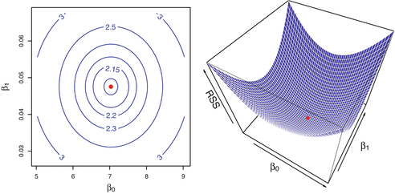{width="42%"}

OLS minimizes RSS: the red dot is the bottom of the RSS "bowl" of a simple regression (axes: intercept $\beta_0$ and slope $\beta_1$; left: contours, right: surface). Ridge penalizes slopes, never the intercept.

*Source: James, Witten, Hastie & Tibshirani (2013), ISLR, Fig. 3.2 (Advertising data; contours: RSS in thousands, predictor TV).*

# Shrinkage interpretation: geometry

Ridge = the first RSS contour touching the disk $\beta_1^2 + \beta_2^2 \le \tau$ (larger $\lambda \Leftrightarrow$ smaller $\tau$).

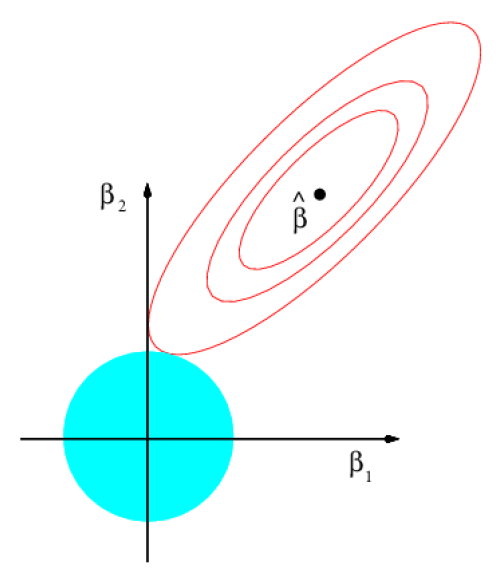{width="30%"} 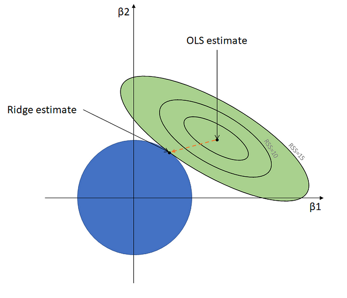{width="34%"}

*Left: Hastie, Tibshirani & Friedman (2009), ESL, Fig. 3.11 (ridge panel). Right: schematic (the actual ridge path is usually curved).*

# Bias–variance trade-off

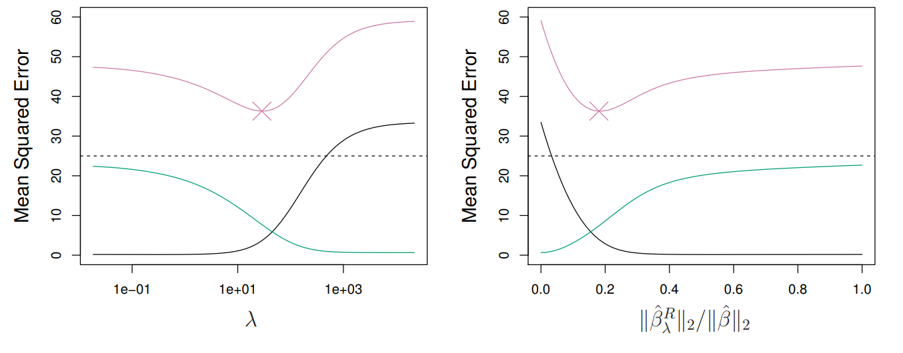{width="62%"}

Black: bias²; green: variance; purple: test MSE (× = minimum; dashed: irreducible error). As $\lambda$ grows: bias² ↑, variance ↓, and test MSE is U-shaped (Chapter 1). Right panel: 1 = OLS, 0 = fully shrunk. *Source: James et al. (2013), ISLR, Fig. 6.5 (simulated data, n = 50, p = 45: a high p/N setting).*

# Interactive ridge demo: what to try

**Try:** (0) press **▶ Sweep λ** and watch the right panel: bias² (black) rises, variance (green) falls, and the excess test MSE (purple, their sum) is U-shaped; where is its minimum? (1) drag **λ**: the ridge point slides along its path from OLS to 0. (2) Set **ρ = 0**, then **ρ = 0.9**: how do the coefficient paths, and ridge's gain over OLS, change? (3) Raise **σ**: does the oracle λ\* go up or down? (Orthonormal-case guide: $\lambda^* = p\sigma^2/\|\boldsymbol\beta\|_2^2 = 3.2$ at σ = 2; the readout's λ\* at ρ = 0 should be close.)

λ\* minimizes the *true* test MSE, which is unknown in practice; cross-validation estimates it (amber dashed line: 10-fold CV on the displayed sample). The demo's λ is on the RSS + λΣβⱼ² scale, with N = 30 and true β = (1.5, 0.5).

::: {.callout-note collapse="true" title="What you should see"}
(0) The purple curve bottoms out at the oracle λ\* (dot). (1) The ridge point moves from OLS toward 0 along a curved path. (2) With ρ = 0.9 the two coefficient paths are pulled toward each other and ridge's gain over OLS grows (OLS's own test MSE does not depend on ρ in this design). How λ\* moves with ρ depends on σ and β. (3) Raising σ raises λ\*: more noise, more shrinkage. The CV-chosen λ scatters around λ\* from sample to sample (click *New sample*).
:::

# Interactive ridge demo

<iframe src="ridge-demo.html" width="100%" height="480" style="border:1px solid #ddd; border-radius:6px"></iframe>

[Open the demo in a new tab](ridge-demo.html){target="_blank"}

# Ridge via OLS estimation

- Ridge can be written as an OLS problem on "augmented" data:
  $$\tilde{\mathbf{y}} = \begin{bmatrix}\mathbf{y}\\ \mathbf{0}_p\end{bmatrix}, \qquad \tilde{\mathbf{X}} = \begin{bmatrix}\mathbf{X}\\ \sqrt{\lambda}\,\mathbf{I}_p\end{bmatrix}$$
- Running OLS on the augmented data gives exactly the ridge estimator:
  $$\hat{\boldsymbol\beta}_\lambda^R = \arg\min_{\boldsymbol\beta}\,(\tilde{\mathbf{y}}-\tilde{\mathbf{X}}\boldsymbol\beta)'(\tilde{\mathbf{y}}-\tilde{\mathbf{X}}\boldsymbol\beta)$$
- Bayesian view (optional): ridge is the posterior mode under the Gaussian prior $\boldsymbol\beta \sim N(\mathbf{0}, (\sigma^2/\lambda)\mathbf{I})$.

# Ridge via OLS: the augmented data in full

$$\tilde{\mathbf{y}} = \begin{bmatrix} y_1\\ \vdots\\ y_N\\ 0\\ \vdots\\ 0\end{bmatrix}, \qquad \tilde{\mathbf{X}} = \begin{bmatrix} x_{11} & x_{21} & \cdots & x_{p1}\\ \vdots & \vdots & & \vdots\\ x_{1N} & x_{2N} & \cdots & x_{pN}\\ \sqrt\lambda & 0 & \cdots & 0\\ 0 & \sqrt\lambda & \cdots & 0\\ \vdots & & \ddots & \vdots\\ 0 & 0 & \cdots & \sqrt\lambda\end{bmatrix}$$

# Ridge advantage

- Unlike OLS, the ridge problem always has a unique solution (for $\lambda > 0$), even when $p > N$:
  - the columns of $\sqrt{\lambda}\,\mathbf{I}_p$ are linearly independent;
  - so the columns of the augmented regressor matrix $\tilde{\mathbf{X}}$ are linearly independent, whether or not those of $\mathbf{X}$ are.
- Ridge can be used where OLS fails ($\mathbf{X}'\mathbf{X}$ singular, e.g. $p > N$).

# LOOCV efficiency: the OLS shortcut
Recall from the OLS review the leave-one-out shortcut for OLS; here it pays off directly in cheap tuning of $\lambda$.

In LOOCV we would normally fit the model $N$ times. For OLS, the LOOCV MSE can be computed from a **single fit** on the full data.

1. **Key definitions**
   i. Vector of residuals: $\mathbf{e} = \mathbf{y} - \mathbf{X}\hat{\boldsymbol\beta}$
   ii. Hat matrix $\mathbf{P}$: projects $\mathbf{y}$ onto the column space of $\mathbf{X}$, $\hat{\mathbf{y}} = \mathbf{P}\mathbf{y}$, with $\mathbf{P} = \mathbf{X}(\mathbf{X}'\mathbf{X})^{-1}\mathbf{X}'$
   iii. Leverage $h_{ii}$: the $i$-th diagonal element of $\mathbf{P}$ – the influence of observation $i$ on its own fitted value:
   $$h_{ii} = \mathbf{x}_i'(\mathbf{X}'\mathbf{X})^{-1}\mathbf{x}_i$$

# LOOCV efficiency: the OLS shortcut

2. **The LOOCV identity.** Let $\tilde e_i = y_i - \tilde y_i$ be the cross-validation residual, where $\tilde y_i$ is the prediction for observation $i$ from a model trained without it. It can be shown that
   $$\tilde e_i = \frac{e_i}{1-h_{ii}}$$
3. **Final MSE calculation.** Instead of retraining $N$ times:
   $$\text{MSE}_{\text{LOOCV}} = \frac{1}{N}\sum_{i=1}^{N}\left(\frac{e_i}{1-h_{ii}}\right)^2$$

# LOOCV shortcut: proof sketch (1/3)

- Running OLS on the whole data gives $\mathbf{y} = \mathbf{X}\hat{\boldsymbol\beta} + \mathbf{e}$; define $h_{ii} = \mathbf{x}_i'(\mathbf{X}'\mathbf{X})^{-1}\mathbf{x}_i$.

:::: {.columns}
::: {.column width="62%"}
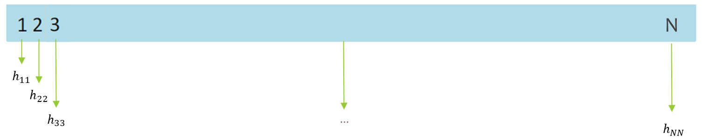{width="100%"}
:::
::: {.column width="38%"}
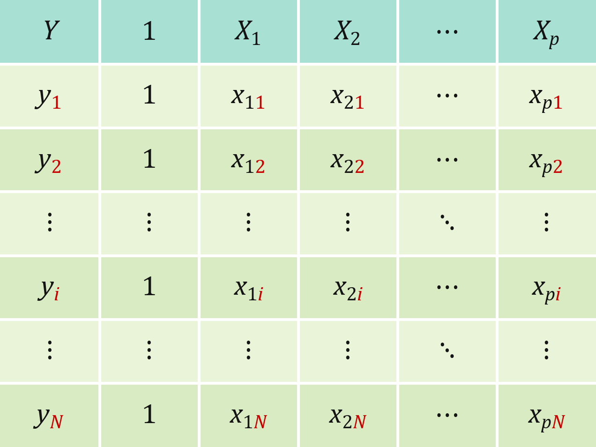{width="100%"}
:::
::::

- **If** we train without observation $i = 3$: $\mathbf{y}_{-3} = \mathbf{X}_{-3}\hat{\boldsymbol\beta}_{-3} + \mathbf{r}$ (residual vector of this fit).

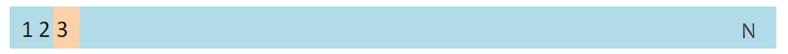{width="55%"}

- Use $\hat{\boldsymbol\beta}_{-3}$ to predict observation 3: $\tilde y_3 = \mathbf{x}_3'\hat{\boldsymbol\beta}_{-3} \Longrightarrow y_3 - \tilde y_3 = \tilde e_3$.
- **It can be shown that** (an implicit equation in $\tilde e_3$, solved on the next two slides): $\hat{\boldsymbol\beta}_{-3} = \hat{\boldsymbol\beta} - (\mathbf{X}'\mathbf{X})^{-1}\mathbf{x}_3\,\tilde e_3$.

# LOOCV shortcut: proof sketch (2/3)

Then

$$\tilde y_3 = \mathbf{x}_3'\hat{\boldsymbol\beta}_{-3} = \mathbf{x}_3'\left(\hat{\boldsymbol\beta} - (\mathbf{X}'\mathbf{X})^{-1}\mathbf{x}_3\tilde e_3\right) = \mathbf{x}_3'\hat{\boldsymbol\beta} - \mathbf{x}_3'(\mathbf{X}'\mathbf{X})^{-1}\mathbf{x}_3\tilde e_3 = (y_3 - e_3) - \mathbf{x}_3'(\mathbf{X}'\mathbf{X})^{-1}\mathbf{x}_3\tilde e_3$$

So: $\;\tilde y_3 = (y_3 - e_3) - h_{33}\,\tilde e_3$.

::: {.callout-note collapse="true" title="Why is β̂₋₃ = β̂ − (X′X)⁻¹x₃ẽ₃?"}
Dropping row 3 gives $(\mathbf{X}'\mathbf{X} - \mathbf{x}_3\mathbf{x}_3')\hat{\boldsymbol\beta}_{-3} = \mathbf{X}'\mathbf{y} - \mathbf{x}_3 y_3$, so $\mathbf{X}'\mathbf{X}\hat{\boldsymbol\beta}_{-3} = \mathbf{X}'\mathbf{y} - \mathbf{x}_3(y_3 - \mathbf{x}_3'\hat{\boldsymbol\beta}_{-3}) = \mathbf{X}'\mathbf{y} - \mathbf{x}_3\tilde e_3$. Multiply by $(\mathbf{X}'\mathbf{X})^{-1}$.
:::

# LOOCV shortcut: proof sketch (3/3)

$$\tilde e_3 = y_3 - \tilde y_3 = e_3 + h_{33}\tilde e_3 \;\Longrightarrow\; e_3 = \tilde e_3(1-h_{33}) \;\Longrightarrow\; \tilde e_3 = (1-h_{33})^{-1}e_3$$

Observation $i = 3$ was chosen only for illustration purposes; what we prove for $i = 3$ applies to all observations.

# Quick check

1. What happens to the LOOCV residual $\tilde e_i = e_i/(1-h_{ii})$ as $h_{ii} \to 1$? What does a leverage close to 1 mean?
2. Why does LOOCV for OLS need only one regression, not $N$?

::: {.callout-tip collapse="true" title="Answers"}
1. $\tilde e_i$ blows up: an observation with leverage near 1 almost determines its own fitted value, so leaving it out changes its prediction a lot.
2. $\tilde e_i$ depends only on the full-sample residual $e_i$ and the leverage $h_{ii}$, and both come from the single full-sample fit.
:::

# Choice of λ: cross-validation

- Most popular choice: cross-validation (LOOCV or $K$-fold) on a grid for $\lambda$.
- CV can be tricky: the minimum may occur at $\lambda = 0$ (OLS), or as $\lambda\to\infty$ (full shrinkage).

# LOOCV shortcut for ridge

- Ridge is OLS on the augmented data $(\tilde{\mathbf{y}}, \tilde{\mathbf{X}})$; leaving out observation $i$ drops only real row $i$ (the $p$ pseudo-rows stay), so for fixed $\lambda$ and fixed scaling the same leave-one-out identity holds, with $h_{ii}(\lambda) = \mathbf{x}_i'(\mathbf{X}'\mathbf{X}+\lambda\mathbf{I}_p)^{-1}\mathbf{x}_i$ (for centered $\mathbf{X}$; add $1/N$ to the leverage if an intercept is fitted):
  $$\tilde e_i(\lambda) = \Big(1 - \mathbf{x}_i'(\mathbf{X}'\mathbf{X}+\lambda\mathbf{I}_p)^{-1}\mathbf{x}_i\Big)^{-1}e_i(\lambda), \quad e_i(\lambda) = y_i - \mathbf{x}_i'\hat{\boldsymbol\beta}_\lambda^R, \quad \text{CV}(\lambda) = \frac{1}{N}\sum_{i=1}^{N}\tilde e_i^2(\lambda)$$

::: {.callout-note collapse="true" title="OLS case ($\lambda = 0$)"}
$h_{ii} = \mathbf{x}_i'(\mathbf{X}'\mathbf{X})^{-1}\mathbf{x}_i$, $\;\hat{\boldsymbol\beta}_{-i} = \hat{\boldsymbol\beta} - (\mathbf{X}'\mathbf{X})^{-1}\mathbf{x}_i\tilde e_i$, $\;\tilde e_i = e_i/(1-h_{ii})$.
:::

# Applications: Credit data

So far we have built ridge from first principles and seen how to tune $\lambda$; let us see it work on real data — the ISLR Credit data.

Data from the ISLR package on credit-card balances (response: Balance) and 10 predictors (11 regressors after dummy coding), $N = 400$ (300 training, 100 test).

::: {style="font-size:78%"}
| Variable | Description |
|---|---|
| Income | Income in \$10,000s |
| Limit | Credit limit (\$) |
| Rating | Credit rating |
| Cards | Number of credit cards |
| Age | Age in years |
| Education | Number of years of education |
| Gender | Factor: Male, Female |
| Student | Factor: No, Yes (student) |
| Married | Factor: No, Yes (married) |
| Ethnicity | Factor: African American, Asian, Caucasian |
| Balance | Average credit-card balance (\$) – the response |
:::

# Applications: the glmnet package

::: {style="font-size:90%"}
- Fit ridge regression with the `glmnet()` function from the **glmnet** package.
- Basic syntax: `fit = glmnet(x, y, alpha = 0, lambda = grid)`
- `alpha = 0` gives the ridge penalty; `alpha = 1` gives LASSO; values between 0 and 1 give the Elastic Net (discussed later).
- If `lambda` is not supplied, `glmnet()` produces its own grid. It may not be optimal – you may need to experiment with user-defined grids!
- Scale: glmnet standardizes $\mathbf{X}$ and measures its penalty in units of $\text{sd}(y)$ (divisor $N$), so its $\lambda$ is not ours: $\lambda_{\text{slides}} = N\lambda_{\text{glmnet}}/\text{sd}(y)$; here $0.61 \leftrightarrow 0.39$ (matches glmnet's fit to 0.02%).

```r
library(ISLR); library(glmnet)
X <- model.matrix(Balance ~ . - ID, data = Credit)[, -1]; Y <- Credit$Balance
set.seed(2457829); train <- sample(1:nrow(X), 300); test <- -train
grid <- 10^seq(10, -2, length = 100)
ridge.mod <- glmnet(X[train, ], Y[train], alpha = 0, lambda = grid, thresh = 1e-12)
cv10   <- cv.glmnet(X[train, ], Y[train], alpha = 0)                          # default grid
cv40   <- cv.glmnet(X[train, ], Y[train], alpha = 0, lambda = seq(0, 40, length.out = 10000))  # [0, 40]; keep this call order: each cv.glmnet draws random folds
cv20   <- cv.glmnet(X[train, ], Y[train], alpha = 0, lambda = seq(0, 20, length.out = 100))
cvloo  <- cv.glmnet(X[train, ], Y[train], alpha = 0, lambda = seq(0, 20, length.out = 100), nfolds = 300)
pred   <- predict(ridge.mod, s = cv20$lambda.min, newx = X[test, ], exact = TRUE, x = X[train, ], y = Y[train])
```
:::

# Applications: effects of λ on coefficients

As $\lambda$ grows, coefficients shrink toward 0 (reached only as $\lambda\to\infty$), but paths need not be monotone: Rating first rises, taking weight from the highly correlated Limit, and Income changes sign.

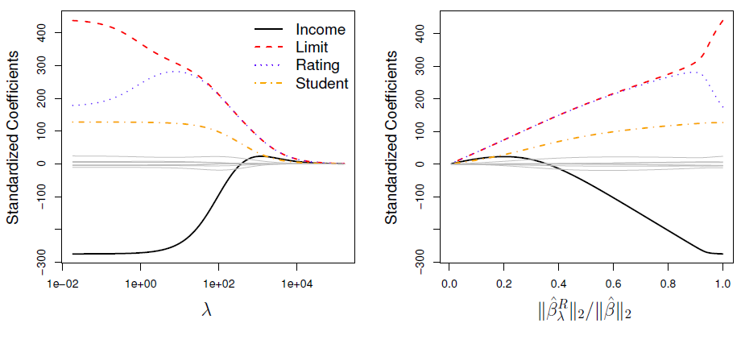{width="72%"}

*Source: James et al. (2013), ISLR, Fig. 6.4 (Credit data, all 400 observations, standardized coefficients). Right panel: 1 = OLS, 0 = fully shrunk. The λ values in this figure are not comparable with those on the next slides (different sample and scaling).*

# Applications: 10-fold CV to find the best λ

:::: {.columns}
::: {.column width="55%"}
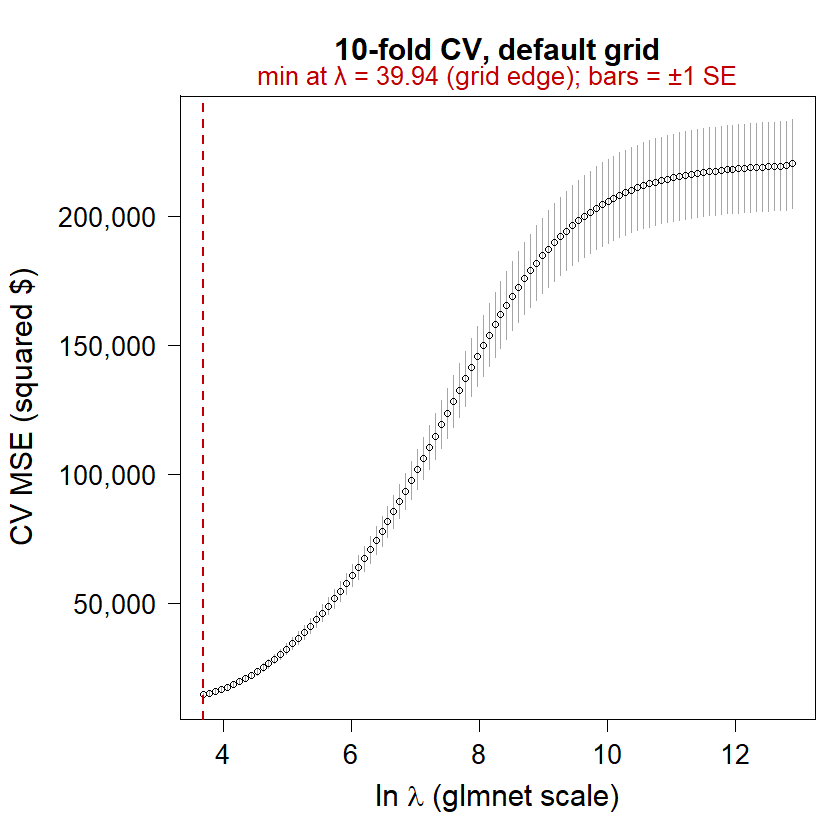{height="560"}
:::
::: {.column width="45%"}
- Here we use glmnet's default grid for $\lambda$.
- The best $\lambda$ found is **39.94** – the smallest value in the default grid (a boundary solution).
- So we search lower values on a user-defined grid. All CV here uses the 300 training observations.
:::
::::

# Applications: 10-fold CV to find the best λ

:::: {.columns}
::: {.column width="55%"}
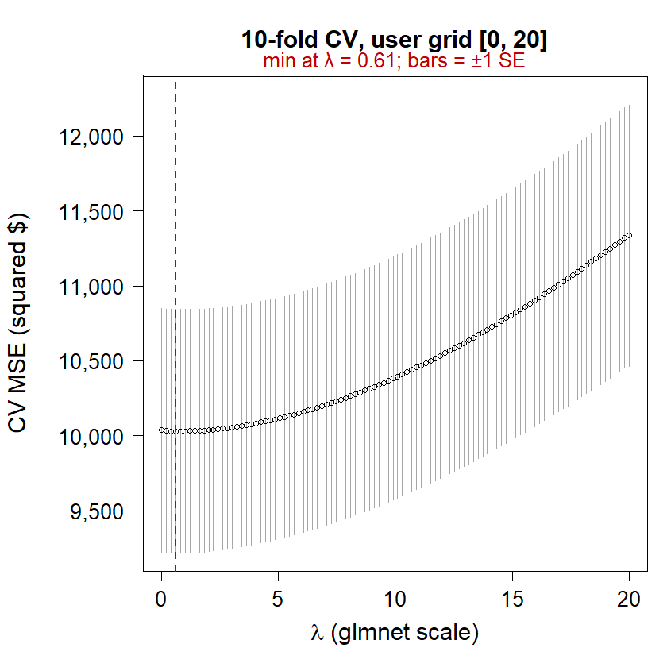{height="560"}
:::
::: {.column width="45%"}
- User-defined grid: 100 equally spaced values on $[0, 20]$.
- The best $\lambda$ found is **0.61** (the 4th grid point). The CV curve is flat near 0: a finer grid on $[0, 40]$ (each CV run draws its own random folds) gives 0.34, so $\lambda$ is only weakly pinned down.
:::
::::

# Applications: LOOCV to find the best λ

:::: {.columns}
::: {.column width="55%"}
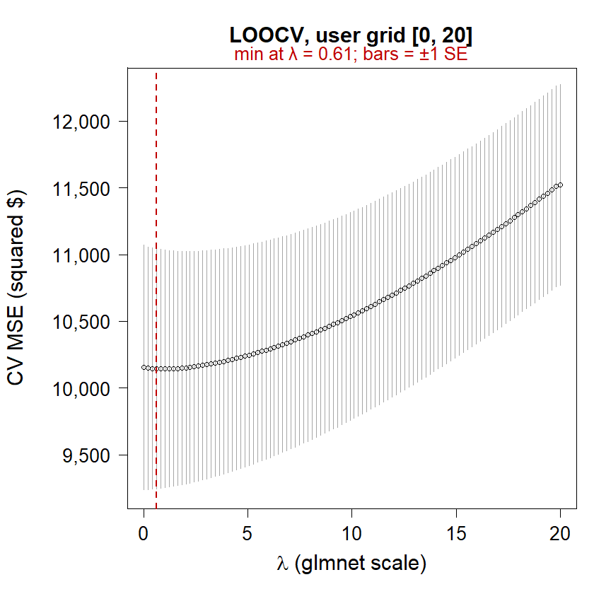{height="560"}
:::
::: {.column width="45%"}
- The best $\lambda$ found is **0.61** – the same as 10-fold CV (same grid; LOOCV = 300 folds). `cv.glmnet` refits 300 times; the shortcut needs one fit per $\lambda$ (next slide).
:::
::::

# LOOCV shortcut in practice

- OLS on the 300 training observations: shortcut CV = 10,148.09; 300 explicit refits = 10,148.09 – identical, but the shortcut takes milliseconds instead of about 0.3 s.
- Ridge at $\lambda = 0.39$ on our scale (0.61 in glmnet), standardization held fixed: shortcut = refits = 10,131.75.
- `cv.glmnet`'s LOOCV at the same $\lambda$ gives 10,143.88: it re-standardizes $\mathbf{X}$ and $y$ in each fold and refits with glmnet's default convergence tolerance – close to, but not exactly, the shortcut.
- **Lesson:** for OLS and ridge (fixed $\lambda$, fixed scaling), LOOCV costs one fit per $\lambda$, not $N$.

# Quick check: choosing lambda

1. The default grid's CV minimum was at its smallest $\lambda$. Why is that a warning sign, and what should you do?
2. With $N = 300$ training observations and 11 regressors, would you expect ridge to beat OLS by much on the test set? Why or why not?

::: {.callout-tip collapse="true" title="Answers"}
1. The true minimum may lie outside the grid, so the chosen $\lambda$ is just the grid edge: extend or refine the grid (here: $[0, 20]$).
2. Probably not: with $p/N$ small, OLS variance is already low, so there is little variance for ridge to remove (the next slide confirms this).
:::

# Out-of-sample (test) MSE

::: {style="font-size:88%"}
| Criterion | $\lambda$ | Test MSE | SE |
|---|---:|---:|---:|
| 10-fold CV (default) | 39.94 | 11,959 | 1,207 |
| 10-fold CV (user) | 0.61 | 10,147 | 1,365 |
| LOOCV | 0.61 | 10,147 | 1,365 |
| OLS (lm) | – | 10,147 | 1,400 |
| Best subset (k = 6) | – | 10,156 | 1,348 |

- Train 300 / test 100 (`set.seed(2457829)`). SE = standard error of each test MSE over the 100 test observations. Best subset: k = 6 (Income, Limit, Rating, Cards, Age, Student), chosen by 10-fold CV in Chapter 2. MSE in squared dollars; $\lambda$ on glmnet's scale (0.61 ↔ 0.39 on ours).
- Why ridge ≈ OLS: with $N = 300$ and 11 regressors, OLS variance is already small, so CV picks little shrinkage (cf. $\lambda^* = p\sigma^2/\|\boldsymbol\beta\|_2^2$). Collinearity (Limit–Rating, r = 0.997) unsettles single coefficients (next slide) but barely hurts prediction.
- Gaps vs OLS are within sampling noise: ridge −0.9 (paired SE 85), best subset +8 (145); the default grid does worse, +1,812 (1,460).
:::

# Model: coefficients

:::: {.columns}
::: {.column width="55%"}
| Variable | Ridge ($\lambda = 0.61$) | OLS (lm) |
|---|---:|---:|
| Income | −7.941 | −7.992 |
| Limit | 0.165 | 0.185 |
| Rating | 1.558 | 1.264 |
| Cards | 16.435 | 17.789 |
| Age | −0.578 | −0.567 |
| Education | −0.071 | −0.188 |
| Female | −9.772 | −9.964 |
| Student | 424.981 | 426.817 |
| Married | 0.454 | 1.367 |
| Asian | 14.426 | 14.132 |
| Caucasian | 2.115 | 2.251 |
:::
::: {.column width="45%"}
- $\lambda = 0.61$ on glmnet's scale (0.39 on ours). Original scale (\$ of Balance per unit of each regressor; Income in \$10,000s).
- Intercepts: −511.04 (ridge), −505.12 (OLS). Base: Male, non-student, unmarried, African American.
- Ridge shrinks the size of the standardized coefficient vector (557.7 vs. 575.8 for OLS), not each coefficient: Limit and Rating (correlation 0.997) share weight – Limit ↓, Rating ↑; Married and Education shrink most proportionally.
:::
::::

# Check your understanding

1. What happens to the ridge estimator as $\lambda \to 0$? As $\lambda \to \infty$?
2. For the augmented data on the "Ridge via OLS" slide, verify that $\tilde{\mathbf{X}}'\tilde{\mathbf{X}} = \mathbf{X}'\mathbf{X} + \lambda\mathbf{I}_p$ and $\tilde{\mathbf{X}}'\tilde{\mathbf{y}} = \mathbf{X}'\mathbf{y}$.
3. Why should predictors be standardized before ridge, but not before OLS?
4. In the orthonormal case the best penalty is $\lambda_j^* = \sigma^2/\beta_j^2$. What happens to $\lambda_j^*$ if the noise $\sigma$ doubles? If the true $\beta_j$ is tiny?

::: {.callout-tip collapse="true" title="Answers"}
1. $\lambda\to 0$: ridge → OLS (when $\mathbf{X}'\mathbf{X}$ is invertible). $\lambda\to\infty$: all slope coefficients → 0 (only the intercept $\bar y$ remains).
2. $\tilde{\mathbf{X}}'\tilde{\mathbf{X}} = \mathbf{X}'\mathbf{X} + (\sqrt\lambda\mathbf{I}_p)'(\sqrt\lambda\mathbf{I}_p) = \mathbf{X}'\mathbf{X} + \lambda\mathbf{I}_p$; $\tilde{\mathbf{X}}'\tilde{\mathbf{y}} = \mathbf{X}'\mathbf{y} + \sqrt\lambda\mathbf{I}_p\mathbf{0}_p = \mathbf{X}'\mathbf{y}$.
3. OLS is scale equivariant (rescaling $x_j$ just rescales $\hat\beta_j$); the ridge penalty $\sum\beta_j^2$ is not, so unstandardized units would decide how hard each coefficient is shrunk.
4. Doubling $\sigma$ quadruples $\lambda_j^*$; a tiny $\beta_j$ makes $\lambda_j^*$ very large – shrink hard when signal is weak relative to noise.
:::

# Concluding remarks

- Ridge is well-defined even if $p > N$.
- Ridge never sets coefficients exactly to zero, so it does **not** perform variable selection.
- LOOCV for OLS and ridge (fixed $\lambda$) needs one fit per $\lambda$, not $N$: the hat-matrix shortcut.
- Ridge requires a choice of the tuning parameter $\lambda$, made by cross-validation.
- Works best when the signal is "dense": many $X$ variables matter, each with a small coefficient (where ridge tends to beat LASSO – next lecture).
- On the Credit data, CV picks a small $\lambda$ and ridge ≈ OLS ($N = 300$, 11 regressors): collinearity unsettles coefficients, not predictions; ridge pays off when $p/N$ is high.
- In practice: check that the CV-chosen $\lambda$ is not at the edge of the grid.
- **Next lecture:** LASSO uses the penalty $\sum_j|\beta_j|$ instead of $\sum_j\beta_j^2$ – it shrinks **and** selects.

*Optional aside: ridge shrinks most along the principal components of $\mathbf{X}$ with the smallest variance (ESL §3.4.1).*
